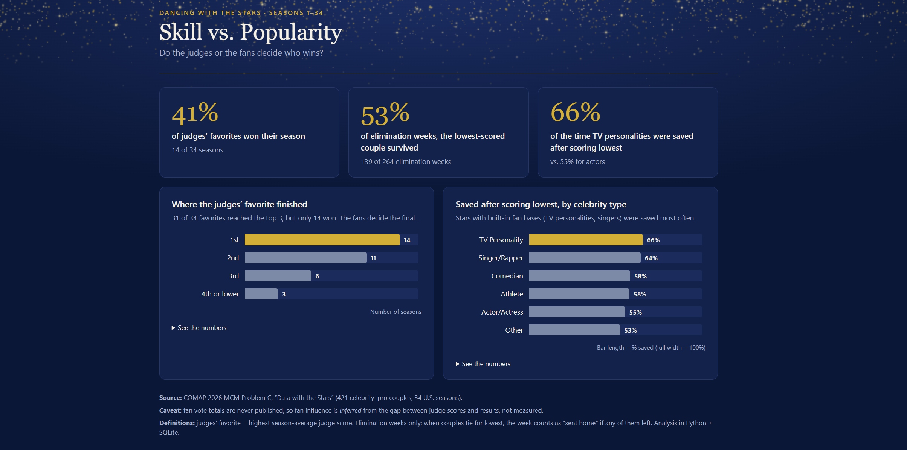

# Skill vs. Popularity: Do Judges or Fans Decide *Dancing with the Stars*?

On *Dancing with the Stars*, each week's result combines the judges' scores with fan votes.
This project uses judge scores from 34 U.S. seasons (421 celebrity–pro couples) to measure how often the fans override the judges.

**[View the live dashboard →](https://abbygopal.github.io/dwts-judges-vs-fans/dashboard/)**



## Key findings

1. **The judges' favorite won only 14 of 34 seasons (41%).** Yet 31 of those 34 favorites reached the top 3: the judges' top couple almost always makes the finale, and then the fans decide who wins.
2. **In 139 of 264 elimination weeks (53%), the couple with the lowest judge score was *not* sent home.** The judges' bottom couple survived more often than not.
3. **Celebrities with built-in fan bases were saved most often.** When they had the lowest score, TV personalities were saved 66% of the time (46 of 70) and singers/rappers 64%, compared with 55% for actors (41 of 74). The gap is about 7 weeks' worth of results, so it's suggestive rather than proof.

## Questions and definitions

| # | Question | How it's measured |
|---|---|---|
| 1 | How often does the judges' favorite win the season? | Favorite = the couple with the highest **season-average** judge score (the average of each week's per-judge average). |
| 2 | How often does the lowest-scored couple survive? | Only the 264 weeks where at least one couple was eliminated. The 44 weeks with no elimination are skipped. |
| 3 | Which kinds of celebrities are saved most often? | Every time a couple was (tied for) lowest in an elimination week, grouped by `celebrity_industry`. Industries with fewer than 20 such weeks are grouped as "Other". |

*Considered and set aside:* whether the "judges' save" (Seasons 28–31, when judges picked who left from the bottom two) reduced upsets. With only 4 seasons (33 elimination weeks), and no data on which couples were in the bottom two, the data can't answer it reliably.

## Data

- **Source:** COMAP 2026 MCM Problem C, "Data with the Stars"
  (<https://comap.org/membership/member-resources/item/data-with-the-stars>). Free to download; not re-published in this repo.
- One row per celebrity + pro partner per season, with 44 weekly judge-score columns (11 weeks × up to 4 judges).

### Data cleaning decisions

- **Reshaped wide to long** (`pd.melt`): 44 score columns became one row per couple, week and judge (9,112 real scores).
- **Zeros removed:** a 0 means the couple had already been eliminated. Checked first: zeros never appear before or mixed in with a couple's real scores.
- **"N/A" removed:** no 4th judge that season, or the week didn't happen.
- **3 vs. 4 judges:** all comparisons use the **average score per judge**, never totals.
- **Scores above 10 kept:** per COMAP's notes, bonus points (dance-offs, etc.) were spread across the judge scores, and team dances were averaged in. Bonuses counted on the show, and every comparison is within the same week.
- **Ties and double eliminations** are counted conservatively: a week counts as "lowest went home" if *any* tied-lowest couple left, so fan influence isn't overstated.
- **Withdrawals** (10 celebrities) are not counted as eliminations. One inconsistent industry label was merged.

### Caveats

- Fan vote totals are never released, so fan influence is **inferred** from the gap between judge scores and results, not measured directly. In Seasons 28–31, the judges could also keep a low scorer through the judges' save.
- The judges' favorite is based on a season average, and later weeks score higher. That gives couples who last longer (including eventual winners) a small boost, so finding 1 likely *overstates* how often the favorite wins.

## Tools

Python (pandas) for cleaning, SQLite + SQL for analysis (CTEs, window functions, joins), HTML/CSS/JavaScript for the dashboard, Git and GitHub.

## Project structure

```
data/raw/        COMAP's CSV (not in the repo; download it from the link above)
scripts/         clean_data.py: CSV -> SQLite;  export_results.py: SQL results -> CSVs + dashboard data
sql/             00_data_checks.sql, then one file per question (01-03), with notes on each decision
outputs/         query results as CSV files
dashboard/       index.html (open in any browser), data.js, sparkles.png
```

## How to run it

1. Download the data from COMAP and save the CSV as `data/raw/2026_MCM_Problem_C_Data.csv`.
2. Set up Python (Windows PowerShell shown):
   ```
   py -m venv .venv
   .\.venv\Scripts\Activate.ps1
   pip install -r requirements.txt
   ```
3. Build the database, then export the results:
   ```
   py scripts/clean_data.py
   py scripts/export_results.py
   ```
4. Open `dashboard/index.html` in a web browser.
